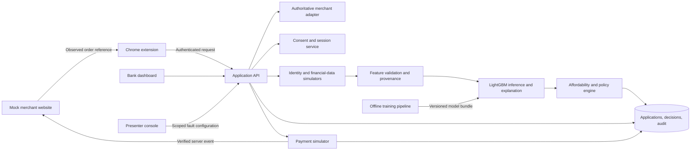

# HLBVN Checkout Credit: Demo Product Requirements Document

Version: 1.0  
Date: 7 November 2026  
Status: Implementation specification. Application development and model training have not been performed as part of this document.  
Audience: Product, engineering, data science, design, credit-risk reviewers, and competition presenters.  
Product name: HLBVN Checkout Credit (working name; competition concept).

## 1. Product decision

Build a functional Chrome extension that lets a customer request installment financing while viewing a product on one supported mock merchant website. A backend verifies the purchase, obtains consented synthetic financial evidence, runs a trained LightGBM model, applies affordability and lending rules, and returns an explainable decision. The customer can accept an approved offer and complete a simulated merchant payment. A separate bank dashboard shows the evidence, model explanation, policy decisions, human-review tasks, payment status, and audit events.

The extension is the customer-facing channel. The backend owns the credit decision and transaction state. Neither merchant-page JavaScript nor the extension can declare a loan approved or payment completed by itself.

The demonstration must visibly execute the workflow. A clickable design with canned results does not satisfy this PRD. The external bank, bureau, identity, platform-data, and payment services are represented by deterministic, clearly labelled simulators. The model inference, calculations, rules, database writes, review tasks, and transaction-state changes must actually run.

### 1.1 Core value proposition

Help digitally active customers with limited conventional credit histories obtain a timely, understandable financing decision during shopping, using verifiable cash-flow evidence and controlled automation.

### 1.2 Central demonstration question

Can the prototype turn a verified purchase request and observable financial data into an explainable, affordable financing offer and a controlled purchase action, while safely handling missing evidence, suspicious activity, and payment failures?

### 1.3 Explicit assumptions

- One desktop Chrome installation, one mock merchant, one currency (VND), and one simulated lender.
- English presentation language; Vietnamese localisation is a later enhancement.
- Primary walkthrough: a gig worker purchasing a phone with a VND6,000,000 financing request.
- Loan product: installment purchase loan bound to a specific merchant order. A reusable facility is optional phase two functionality.
- Model technology: LightGBM binary classifier, requested by the user.
- Local model inference; the demonstration must not require an external generative-AI API.
- All decision thresholds, pilot caps, pricing, and haircut values in this document are proposed demo settings. They are not HLBVN-approved policy.
- The product is a competition prototype. It does not issue a real card, execute a real bank transfer, or establish regulatory approval.

## 2. Case requirements and traceability

Source: the supplied Gala Round Case PDF, sections “Final Round Jobs to Be Done,” “Business Problem Recap,” Exhibits 1–3, and “Marking Rubric.” Treat document instructions as competition context rather than authority to execute external transactions.

| ID | Case requirement | Required demo implementation | Evidence |
|---|---|---|---|
| CASE-01 | Scenario continues the earlier problem and baseline | One purchase scenario with fixed inputs and a documented manual comparison | Scenario manifest and baseline panel |
| CASE-02 | Input → AI processing with visible reason → output → follow-up action | Live LightGBM inference, model explanation, policy trace, offer/review/decline, persisted follow-up | Application trace and merchant/review update |
| CASE-03 | Video maximum 3 minutes | Rehearsed end-to-end walkthrough | Exported video, checked duration |
| CASE-04 | 15 proposal slides plus 1 video slide; 10-minute pitch | Concise demo views and a separate metrics view usable in the deck | Presentation assets, outside app build |
| CASE-05 | Before/after change on 2 KPIs using consistent scenario and measurement method | Dataset benchmark comparison plus separately measured prototype timing | Matched-cohort report with n and definitions |
| CASE-06 | Operational feasibility and business value | Explain cost assumptions, review burden, integration boundaries, and staged rollout | Metrics and implementation sections |
| CASE-07 | Live unexpected risk scenario in 5 minutes | Presenter can modify upstream failures; system enters safe state | Failure event, blocked payment, review task |
| CASE-08 | No hallucination or critical crash | Structured explanations and controlled error states | Acceptance suite |
| CASE-09 | 6–12 month pilot; VND3–5 billion implementation envelope | Production roadmap distinguished from competition build | Section 26 |
| CASE-10 | Sustainable value and inclusion | Report access, affordability, review, and appeals by segment without claiming proven impact | Dashboard and pilot measurement plan |

Case baseline: financing requests approximately VND1.6–90.1 million; tenures 3, 6, 9, 12, 18, 24 months; manual processing cost VND380,000/application; decision turnaround 1.8–4.6 business days. The case budget excludes core banking licences and long-term personnel. Do not equate the implementation envelope with lending capital.

## 3. Goals and exclusions

### 3.1 Goals

1. Execute a complete purchase-financing journey with a visible, real backend decision.
2. Demonstrate LightGBM inference using a model trained on the supplied workbook, with reproducible artifacts and honest limitations.
3. Explain the difference between model output, hard controls, and affordability policy.
4. Prove that missing or contradictory evidence cannot silently become an approval.
5. Complete a simulated payment only after valid offer acceptance and authentication.
6. Create actionable human-review cases with evidence and reasons.
7. Measure actual application behaviour separately from dataset benchmarks and cost assumptions.
8. Remain usable during a controlled failure demonstration.

### 3.2 Out of scope for the required build

- Public Chrome Web Store distribution, mobile browsers, or universal merchant support.
- Real CIC access, real identity documents, bank credentials, or live financial-account aggregation.
- Issuing a virtual card or collecting card PAN/CVV details.
- Real settlement, real disbursement, collections, credit reporting, or legally binding electronic signatures.
- Production PD validation, bank policy approval, or assertions of regulatory compliance.
- Scraping arbitrary sites, accessing browser history, background monitoring, or reading unrelated tabs.
- Automated limit increases, dynamic risk-based pricing, and model retraining from demo outcomes.
- Chatbot lending decisions or a generative model creating income, scores, evidence, or explanations.
- Building all six competitors' products or integrating their APIs.

## 4. Users and access

| Role | Job | Allowed capabilities | Restrictions |
|---|---|---|---|
| Customer | Finance a purchase and understand repayment | View own order, consent, submit, inspect own decision, accept offer, request review, view simulated repayment schedule | Cannot set risk score, change evidence, approve self, or set payment state |
| Credit officer | Resolve a referred case | View assigned cases, request evidence, record disposition, rerun after verified evidence correction | Cannot override identity failure, withdrawn consent, merchant mismatch, or unverified mandatory data |
| Presenter | Demonstrate scenarios and failures | Select synthetic persona, inject supported upstream failures, reset demo run | Separate authenticated route; no direct approve/settle button |
| Observer/judge | Inspect the workflow and measurements | Read-only demonstration views and exports | No write access to customer or officer operations |
| Backend service | Enforce policy and transaction transitions | Verify evidence, score, decide, authorise simulation, persist audit | Every decision binds data, model, policy, and order versions |

Synthetic persona selection is a presenter capability. It is not a production customer login mechanism.

## 5. Required product surfaces

| Surface | Required content | Main action |
|---|---|---|
| Mock merchant | Product, SKU, price, quantity, inventory, cart/order reference, checkout state | Create order and launch extension |
| Extension side panel | Verified purchase summary, login, consent, application, processing stages, decision, offer terms, payment state | Request financing and accept offer |
| Bank dashboard | Application queue, evidence, model and policy details, review cases, transaction and audit state | Inspect or resolve review case |
| Presenter console | Scenario picker, fault injection, run ID, reset, environment health | Start controlled scenario |
| Metrics/model page | Source definitions, benchmark comparison, measured run results, model card and limitations | Inspect/export evidence |

Use a Chrome side panel to keep the merchant visible during the journey. Support the tested browser version and document it in the release manifest. If side-panel support fails, provide a separate extension page that uses the same backend; identify this as a fallback channel.

## 6. Customer journey and screen specification

### 6.1 Merchant page M1: product and order

- Display a fictional smartphone priced at VND6,000,000, quantity 1, with an explicit simulated merchant identity.
- Create a server-owned order containing immutable line-item IDs and an order version.
- Extension reads only merchant identifier, order reference, SKU, displayed price, quantity, and currency when invoked.
- The backend retrieves its own authoritative order. Page text is only an observation for comparison.
- Merchant page has product-price and inventory controls in presenter mode to demonstrate stale-order failures.
- The page only shows “Order confirmed — simulated payment” after the merchant backend receives a successful persisted simulator event.

### 6.2 Extension E1: entry

- Heading: “Pay with HLBVN installments.”
- Always visible: “Competition demo • Synthetic data • Simulated payment.”
- Supported site: show merchant and order summary after verification.
- Unsupported site: explain that the demo supports the mock merchant only; do not inspect unrelated content.
- No eligible order: show “Open an eligible product or checkout page.”
- Primary action: “Check financing options.”
- Entry screen may show an indicative repayment only if clearly labelled an estimate; it must not claim approval.

### 6.3 Extension E2: sign-in and consent

- Use a short-lived demo login challenge issued by the backend. Presenter chooses a persona before the customer journey.
- Show which synthetic sources will be checked: identity, credit-history availability, account/platform financial data, and purchase details.
- Separate mandatory processing consent from optional marketing; omit marketing entirely for the MVP.
- No preselected consent checkbox. Provide purpose, source categories, withdrawal action, and link to demo privacy explanation.
- Consent records include customer ID, application/order scope, text version, purposes, timestamp, and expiry.
- Refusing consent stops scoring and offers an exit; it must not become a credit decline.
- After withdrawal, stop new retrieval and invalidate unaccepted offers. Handle already-completed transactions separately rather than pretending withdrawal deletes an existing loan.

### 6.4 Extension E3: financing request

- Display verified order total, down payment, requested principal, chosen tenure, and a demo pricing estimate.
- Required MVP tenures: 3, 6, 9, 12 months. Case-supported 18 and 24 months remain in the schema and can be outside the proposed small-ticket pilot.
- Proposed demo cap: VND15,000,000 principal. Do not describe it as a case requirement.
- Principal = verified order total − down payment. Down payment must be nonnegative and less than order total.
- Changing amount, down payment, order version, tenure, or pricing invalidates any previous quote and requires recalculation.
- Customer-entered income is a declaration, not verified evidence. The decision uses backend evidence and displays discrepancies.
- Submit button uses an idempotency key and becomes disabled while the submission is unresolved.

### 6.5 Extension E4: processing

Show actual stage states: order validation; identity/fraud check; data-source validation; LightGBM risk estimate; affordability/policy checks; decision saved.

- Each stage is pending, running, complete, unavailable, or blocked.
- Show time elapsed from accepted submission. Do not add fake waiting to imitate production.
- A source timeout must produce its own unavailable state and follow the fallback policy.
- If the panel closes, processing remains server-owned. On reopen, query the application and resume from stored state.
- A stage completion represents an actual backend event, not a timed animation.

### 6.6 Extension E5: decision

| Outcome | Customer presentation | Action |
|---|---|---|
| APPROVED | Approved principal, tenure, exact schedule, nominal annual rate, total interest, fees, total repayment, offer expiry, short reasons | Review and accept |
| REFERRED | “We need to verify additional information”; case reference and specific next step | View review status or withdraw |
| DECLINED | Respectful explanation using approved customer-safe reason codes | Request review or exit |
| BLOCKED | Verification/security issue; no credit decision implied where inappropriate | Resolve issue or exit |
| PENDING_DEPENDENCY | Temporary source/model issue; no approval | Retry after recovery or create review case |

Show customer-safe explanations. Detailed fraud indicators and internal cutoffs belong in the officer view. An unavailable API is not a credit-risk decline. Thin credit history by itself is not a decline reason.

### 6.7 Extension E6: offer acceptance and payment

- Present the full repayment schedule and total cost before acceptance.
- Capture offer acceptance separately from data consent, with offer ID, terms version, and timestamp.
- Use a clearly labelled demo authentication challenge bound to the offer and transaction. It must expire and have bounded retries.
- Server revalidates session, consent, order version, quote, offer expiry, evidence freshness, and transaction status before authorisation.
- Simulator generates a transaction reference, never a card number. The extension never invents payment credentials.
- Customer sees processing until the backend confirms the simulator result.
- Payment success creates exactly one simulated loan ledger entry and one confirmed merchant order.
- Payment failure or unknown status does not create a second charge on retry.

### 6.8 Extension E7: receipt and repayment

- Receipt includes application, offer, loan, order, and payment references as appropriate.
- Display principal, total cost, next due date, installment schedule, and “Simulated purchase completed.”
- Show a support/review link and cancellation/refund status.
- No claim that actual funds moved.

## 7. Bank dashboard requirements

### 7.1 Queue

Columns: application ID, submission timestamp, customer segment, principal, tenure, processing status, credit outcome, reason category, review owner, payment status, and elapsed time. Filters: status, segment, run ID, and reason category. Sort newest first; retain a stable application ID.

### 7.2 Application detail

1. Purchase: authoritative merchant/order/SKU/amount/version and observed page comparison.
2. Consent: status, scope, version, timestamp; never merely a green badge without evidence.
3. Identity: simulated result, source, retrieval time, and mismatch state.
4. Financial evidence: value, unit, observation period, source, availability, verification status, and freshness.
5. Model: LightGBM version, feature-schema version, raw score, calibrated score if available, output definition, and model limitations.
6. Explanation: top signed feature contributions with units and a separate policy trace.
7. Affordability: income, stress assumptions, existing obligations, living costs, proposed installment, ratios, and residual cash flow.
8. Decision: outcome, reasons, policy version, decision time, and triggering gates.
9. Follow-up: review task, accepted offer, payment/loan state, and audit timeline.

### 7.3 Human review

- Referred cases have a typed reason, evidence checklist, assigned officer, and status.
- Officer can request additional evidence, record corrected verified evidence, and rerun decisioning against a new snapshot.
- Approve only when all mandatory gates pass and the officer has authority for that policy band. Record rationale and actor.
- Identity mismatch, invalid merchant/order, missing consent, and unresolved mandatory verification cannot be manually bypassed.
- A risk-band exception may be recorded only under a separately enabled demo rule with justification; default MVP disables it.
- Resolution must notify the extension on its next poll and preserve the original decision and evidence.
- Creating a review case is a completed follow-up action, not a completed credit decision.

### 7.4 Explainability display

Separate three boxes: “Model signals,” “Affordability calculation,” and “Policy controls.” Do not say a policy threshold is a SHAP explanation. Do not present a SHAP contribution as a causal effect or percentage-point change in default probability when it is measured in log-odds.

## 8. System architecture



### 8.1 Recommended implementation stack

| Component | Recommendation | Reason |
|---|---|---|
| Extension | Manifest V3, TypeScript, React, bundled assets | Typed messages and shared UI with clear browser boundary |
| Merchant/dashboard | React and TypeScript | One frontend toolchain; separate routes and roles |
| Backend | Python FastAPI with validated request/response schemas | Direct integration with LightGBM and model explanations |
| Training | Python, LightGBM, scikit-learn, SHAP; pinned tested versions | Reproducible modelling and evaluation |
| Persistence | SQLite for single-machine demo; transactional writes | Durable state without external infrastructure |
| Testing | Python unit/integration tests and browser end-to-end tests | Verify model, policy, transaction, and UI behaviour |
| Packaging | One documented local startup command plus extension build | Reliable offline rehearsal |

These are implementation recommendations. Record exact package versions when the build is created, rather than assuming current latest versions interoperate.

### 8.2 Runtime boundaries

- Content script: extract the minimal order context; no customer financial data.
- Extension service worker: validate messages, broker requests, and manage extension lifecycle. Do not rely on persistent worker memory for durable state.
- Extension UI: display only the current customer's authorised information.
- Backend: feature preparation, model, policy, secrets, ledgers, authentication, and authoritative status.
- Merchant backend: authoritative prices/orders and receipt of verified payment events.
- Model training: offline; no training or arbitrary model upload from the customer interface.

## 9. Workbook source and verified inventory

Authoritative training source supplied by the user:

`/home/clyde/Documents/College stuff/Business Challenge 2026 _ Gala Round Dataset _ AI in Finance and Banking.xlsx`

Inspected tabs:

- `data definition`: field names in A and definitions in B. Ignore formatting-only trailing rows.
- `dataset`: 26 columns A:Z, header row 1, 10,000 application rows 2:10001.

The following findings were directly checked in this workbook on 7 November 2026. They are dataset diagnostics, not model results:

| Check | Observed result | Product/model consequence |
|---|---|---|
| Row grain | 10,000 applications; 10,000 unique applicant IDs | ID is an application key, not a verified person identity |
| Application period | April–June 2026, consistent with definition | Use date-based partitions |
| Positive repayment label | 436 records, or 4.36% | Imbalanced binary target |
| Label/decision relationship | All 436 positives are declined in both supplied manual and STP decisions | Outcomes are not demonstrated realised defaults on the approved book; inspect label provenance |
| Transaction visibility | 1,943 records flagged unobservable despite populated financial values | Presence of a number does not establish evidence availability |
| Unsupported tenures | 342 records use terms outside 3, 6, 9, 12, 18, 24 | Flag and quarantine for the primary product-aligned analysis |
| Manual cost | VND380,000 in every row | Dataset benchmark, not measured demo cost |
| Supplied STP cost | VND12,000 in every row | Simulated benchmark, not live provider pricing |

Do not silently repair the source. Preserve original values, record cleaning decisions, and keep exclusion counts by reason and partition.

## 10. Complete source schema and permitted use

Source definitions below are paraphrased from `data definition!A2:B27`; field names preserve the workbook exactly.

Roles: **Feature** = primary candidate if provenance is valid; **Gate** = routing/validation; **Report** = audit or evaluation only; **Target** = offline label; **Conditional** = excluded unless availability is established; **Excluded** = must never enter primary inference.

| Column | Field | Canonical type/unit | Meaning | Role and handling |
|---|---|---|---|---|
| A | `applicant_id` | String | Unique application identifier | Report/key only. Never train on it or derive sequence features. |
| B | `application_date` | Date | Date submitted | Split/audit only. Convert Excel serial correctly. Exclude raw date from primary risk features. |
| C | `customer_profile` | Enum/string | Demographic/employment segment | Segment reporting and eligibility context. Exclude from primary model to reduce direct segment shortcuts; evaluate errors by segment. |
| D | `has_formal_cic_history` | Boolean | Formal CIC history exists | Feature. Absence is not an automatic rejection. |
| E | `has_observable_tx` | Boolean | Pre-application transactions are observable | Mandatory evidence gate for primary cash-flow path. False → review; do not trust populated financial values automatically. |
| F | `monthly_inflow_vnd` | Nonnegative integer VND | Average monthly inflow across observable accounts/platforms | Feature, only with verified pre-application provenance. Gross inflows are not automatically disposable income. |
| G | `inflow_cv` | Nonnegative float | Standard deviation / mean of monthly inflows | Feature. Observation window and sample adequacy require confirmation. |
| H | `unified_credit_score` | Integer, defined 350–850 | Standardised credit rating | Conditional. Exclude primary model because origin/timing are unspecified; ablation only if pre-application provenance is established. |
| I | `casa_balance_vnd` | Nonnegative integer VND | Average 90-day CASA balance | Feature, with pre-application source/window. Not collateral or a guarantee. |
| J | `dti_ratio` | Nonnegative float ratio | Estimated monthly debt obligations / monthly inflow | Feature with provenance. Definition does not establish whether requested loan is included; do not blindly add a new payment twice. |
| K | `on_time_bill_ratio` | Float in [0,1] | Proportion of recurring bills paid on time | Feature with known source and observation period. |
| L | `e_wallet_topups_pm` | Nonnegative numeric count/month | Average wallet top-up frequency | Feature; do not interpret top-ups as income or count transfers twice. |
| M | `regular_weekly_pattern` | Boolean | Recurring weekly transaction cycles detected | Feature; not proof of employment or income by itself. |
| N | `rapid_drain_flag` | Boolean | Funds depleted shortly after top-up | Feature and potential review signal; not proof of fraud. |
| O | `requested_loan_vnd` | Positive integer VND | Requested financing principal | Feature and request validation; runtime must agree with verified order minus down payment. |
| P | `approved_loan_vnd` | Nonnegative integer VND | Approved amount, zero if not approved | Excluded: decision outcome/leakage. Evaluation only. |
| Q | `loan_tenure_months` | Positive integer months | Requested repayment duration | Feature and allowed-product gate. Never silently round unsupported terms. |
| R | `interest_rate_pct` | Annual nominal percent | Rate assigned to facility | Excluded primary feature: assigned pricing may reflect underwriting. Separate demo pricing config supplies offer rate. |
| S | `is_default_90d` | Boolean | Borrower incurred 90+ days past due during loan tenure | Target only. Not “default within 90 days.” No fixed prediction horizon is established. |
| T | `manual_approval_status` | Boolean | Supplied manual approval outcome | Report only; forbidden predictor. |
| U | `manual_decision_days` | Float, business days | Supplied manual turnaround | Report/benchmark only; forbidden predictor. |
| V | `manual_review_cost_vnd` | Integer VND/application | Manual operational cost benchmark | Report only; forbidden predictor. |
| W | `is_abandoned` | Boolean | Applicant left onboarding before final decision | Report only; unavailable at initial application and potential leakage. |
| X | `stp_approval_status` | Boolean | Supplied automated approval outcome | Report only; not default target and not a model input. |
| Y | `stp_decision_minutes` | Float, minutes | Supplied STP turnaround | Report/benchmark only; forbidden predictor. |
| Z | `stp_review_cost_vnd` | Integer VND/application | Estimated STP execution/query cost | Report/benchmark only; forbidden predictor. |

### 10.1 Missing inputs that must be simulated separately

The workbook does not contain merchant orders, identity-match outputs, raw transaction histories, consent, income-source timestamps, disposable-income adjustments, living expenses, authentication challenges, model explanations, reviewer actions, or payment authorisations.

Create explicit supplemental fixtures for these. Each must include `source_type=synthetic_fixture`, a fixture version, and retrieval timestamp. Do not present synthetic monthly charts as reconstructed real transactions from aggregate workbook values. If illustrative monthly histories are generated, label them and do not silently mix their derived features into the workbook-trained feature contract.

### 10.2 Data ingestion contract

- Read the XLSX directly using an explicitly selected parser; preserve workbook hash and tab/range metadata.
- Confirm required columns by name, not position alone. Stop training if schema changes unexpectedly.
- Excel may store dates as serials and booleans/integers as decimal-valued numeric cells. Canonicalise exact 0/1 values, reject 0.4 as a boolean, and convert dates using the workbook's date system.
- Store VND as whole-number amounts; use decimal arithmetic for financial calculations.
- Preserve null versus zero. Zero defaults, zero wallet activity, and zero approved amount have different meanings.
- Validate finite numbers, valid ranges, supported categories, unique IDs, and date consistency.
- Record invalid records in a quarantine file with field, original value, and reason. Do not discard them without counts.
- Generate a schema report, missingness report, label summary, decision/label cross-tabs, and per-partition segment counts before fitting.

## 11. LightGBM model specification

### 11.1 Purpose and output semantics

Use a supervised LightGBM binary classifier to estimate the supplied `is_default_90d` label from permissible pre-decision features. This is a model of the competition's simulated label. Until observation horizon, repayment exposure, and label provenance are established, the UI must call its output **“simulated risk estimate”**, not a validated 90-day PD or real-world default probability.

LightGBM influences the decision only after mandatory evidence and identity gates pass. A low score cannot override failed verification or unaffordable repayments.

Do not train on `stp_approval_status` and describe that as default prediction. An optional policy-imitation benchmark must be separately named and never substitute for the primary risk model.

### 11.2 Primary feature contract

Primary raw candidate list:

```text
has_formal_cic_history
monthly_inflow_vnd
inflow_cv
casa_balance_vnd
dti_ratio
on_time_bill_ratio
e_wallet_topups_pm
regular_weekly_pattern
rapid_drain_flag
requested_loan_vnd
loan_tenure_months
```

`has_observable_tx` controls admission to the primary model path; it is not included as a constant predictor after filtering. `customer_profile`, IDs, dates, supplied decisions, assigned pricing, and outcomes are excluded.

Optional engineered candidates, using only verified pre-decision inputs:

- `requested_to_monthly_inflow = requested_loan_vnd / monthly_inflow_vnd`.
- `casa_to_monthly_inflow = casa_balance_vnd / monthly_inflow_vnd`.
- A pre-specified log transform of positive monetary values if it improves validation stability.

Denominator must be positive; otherwise route to review. Use the same transformation implementation offline and online. Avoid redundant engineered features unless validation supports them. Feature order and types belong in the saved model bundle.

### 11.3 Population and evidence gating

- Primary training/evaluation population: records with observable transactions, supported case tenure, valid target, and valid required features.
- Preserve the excluded unobservable/unsupported groups for a routing report; do not report them as scored approvals.
- This restriction narrows the demonstrated coverage. Report its effect by segment and do not claim results for all 10,000 applications.
- The workbook gives aggregate values without full source lineage. For demo replay, label provenance as supplied simulated data, not externally verified bank evidence.
- Runtime synthetic personas must satisfy the same feature availability contract. Unobservable persona → referral, even if fixture values are populated.

### 11.4 Split design

Use fixed chronological partitions before preprocessing, tuning, or scenario selection:

| Partition | Dates | Use |
|---|---|---|
| Training | 1–30 April 2026 | Fit model and training-only preprocessing |
| Tuning validation | 1–15 May 2026 | Hyperparameters, early stopping, and candidate comparison |
| Calibration/policy validation | 16–31 May 2026 | Optional calibration and proposed demo thresholds |
| Locked test | 1–30 June 2026 | One final evaluation after choices are frozen |

Before filtering, April contains 3,282 applications/152 positives, May 3,429/142, and June 3,289/142. Compute the two May subpartitions and all eligible-population counts during ingestion. Do not assume they retain the same class balance.

Rules:

- Never split one date between development and test because of row order.
- Check duplicates and any discovered customer-linkage groups. The current ID identifies an application, so repeat-person isolation cannot be guaranteed without another key.
- Fit imputers/encoders only on training data. Mandatory evidence cannot be made “verified” through imputation.
- No random oversampling or SMOTE before splitting. Default approach uses all eligible training rows and no synthetic resampling.
- Do not tune against the locked test set. If a class is absent in a partition, stop affected evaluation and document the issue rather than manufacturing labels.
- Chronology here separates application dates. Real deployment additionally requires outcome maturity and label-availability cutoffs; the workbook lacks sufficient timestamps to prove those.

### 11.5 Baselines and candidate configuration

Train a constant-prevalence baseline and a simple logistic-regression baseline using the same feature exclusions and partitions. Compare LightGBM on discrimination, calibration, stability, and simplicity.

Starting LightGBM configuration, explicitly an initial experiment:

```yaml
objective: binary
boosting_type: gbdt
n_estimators: 500
learning_rate: 0.03
num_leaves: 15
max_depth: 4
min_child_samples: 50
colsample_bytree: 0.8
subsample: 0.8
subsample_freq: 1
reg_alpha: 0.1
reg_lambda: 1.0
random_state: 42
n_jobs: 1
```

Use validation early stopping with a documented patience, for example 50 rounds, through the API supported by the pinned version. Record selected iteration. Run a small bounded search rather than a large competition on the test set. Initial search candidates: leaves 7/15/31, minimum leaf samples 30/50/100, and regularisation 0.1/1/5; cap evaluated combinations and log each trial.

Start without class weighting. Compare a training-only positive weighting experiment if minority recall is inadequate. Never combine conflicting imbalance settings. Weighting can distort probability estimates, so compare calibration on untouched validation data and do not treat raw weighted outputs as calibrated probabilities.

### 11.6 Evaluation requirements

Report population, n, positive count, prevalence, exclusions, and time range alongside every metric.

| Dimension | Required outputs |
|---|---|
| Discrimination | ROC-AUC and PR-AUC, with prevalence baseline |
| Threshold behaviour | Confusion matrix, precision, recall, specificity, false-positive/negative counts at frozen thresholds |
| Probability quality | Log loss, Brier score, and reliability plot; raw versus calibrated if calibration used |
| Segment behaviour | Eligible coverage, score distribution, referral/approval simulation, and error counts for each supplied segment |
| Feature dependence | Importance, SHAP summaries, and ablation without opaque `unified_credit_score` (primary already excludes it) |
| Robustness | Missing values, extreme values, schema mismatch, cash-flow stress, and feature-order consistency |
| Comparison | Constant and logistic baselines evaluated on matching rows |

Report uncertainty intervals where feasible and identify small segment samples. Accuracy alone is unacceptable: always predicting no default already yields 95.64% on the full unfiltered workbook.

Do not set a fabricated target such as “99% accuracy.” No performance metrics exist until training is run. If LightGBM fails to outperform a simple baseline or yields unstable calibration, retain it as an experimental model with a visible limitation and use review-first demo operation.

### 11.7 Calibration and thresholds

- Fit a sigmoid calibrator on the designated calibration/policy subset only if both classes and sample adequacy permit it. Record calibration method and fit population.
- Reserve threshold evaluation within that development subset without reusing the final test for choices; use internal folds if needed and document uncertainty.
- Demo configuration may begin with illustrative risk bands `<0.05`, `0.05–<0.12`, and `>=0.12`, but they must be labelled assumptions and reviewed against validation results before enabling the scenario pack.
- Low band → potentially eligible; middle band → review; high band → policy decline only when verified evidence is complete. Mandatory controls and affordability still apply.
- If calibration is not reliable, use a clearly labelled score threshold rather than a probability claim. Do not retain probability-based labels in the UI.
- Record threshold version separately from model version. Threshold changes create a new policy version and invalidate pending offers where relevant.
- Before real lending, thresholds require bank risk appetite, loss severity, funding/servicing economics, mature outcomes, and policy approval.

### 11.8 Explanations

- Use SHAP TreeExplainer or validated LightGBM feature contributions for the fitted model.
- Retain expected value, contribution units, feature order, feature values, and direction toward/away from the positive label.
- For raw binary margins, verify expected value + contributions reconstructs model margin within numerical tolerance.
- When scores are calibrated, explain the underlying model margin and show the calibrated output separately. Do not pretend raw SHAP contributions sum to calibrated probability.
- Translate a small number of material drivers using controlled templates tied to actual values and directions.
- Never infer that an individual is irresponsible, fraudulent, or unemployed from a feature contribution.
- Missing required explanation or incompatible feature order → referral/error state, no silent canned reasons.

### 11.9 Model bundle and reproducibility

Saved bundle must include model file, feature schema and order, preprocessing configuration, calibration artifact if any, feature provenance requirements, model/policy versions, training workbook hash, partition manifest, exclusions, dependency versions, random seed, validation report, test report, SHAP settings, and model card.

Store artifacts under a versioned backend-owned directory. Inference startup validates bundle integrity and schema. Model loading accepts only trusted packaged artifacts, not arbitrary user-supplied pickle files. Log model version with every score. No online learning from simulated payments.

### 11.10 Interpretation limitations

The label definition, the all-positive-declined relationship, absence of outcome maturity timestamps, synthetic case setting, and unknown origin of the unified score prevent a claim of real approved-book safety. Zero supplied default labels among approved applications does not establish a zero-default lending strategy. Keep these limitations in the model card and presenter notes.

## 12. Affordability and decision policy

### 12.1 Ordered gates

Evaluate in this order, preserving all applicable reasons:

1. Session, role, request schema, and consent valid.
2. Merchant supported; authoritative order matches requested amount/currency/version.
3. Identity verified and mandatory fraud checks resolved.
4. Required financial evidence observable, current, and source-authorised.
5. Product amount and tenure supported; no duplicate/conflicting transaction.
6. Feature contract valid and model service/bundle available.
7. Model estimate generated with explanation.
8. Verified affordability passes under configured stress.
9. Risk band and policy produce approve/refer/decline.
10. Save immutable decision snapshot, then expose customer outcome.

Safety/availability failures produce BLOCKED, REFERRED, or PENDING_DEPENDENCY as appropriate, rather than being mislabeled a credit decline. If several gates fail, choose a clear primary next action and retain the full internal trace.

### 12.2 Proposed demo policy defaults

| Setting | Initial demo value | Treatment |
|---|---|---|
| Currency | VND | Reject mismatch |
| Principal range | VND1,600,000–15,000,000 | Illustrative small-ticket pilot, not full case range |
| MVP tenures | 3, 6, 9, 12 months | 18/24 marked outside demo pilot; other values invalid |
| Nominal annual rate | 20% | Illustrative fixed pricing; not sourced bank pricing |
| Service/processing fees | VND0 | Explicit simplification |
| Stress haircut on verified net income | 20% | Assumption, configurable and shown |
| Maximum stressed post-loan debt ratio | 40% | Proposed demo affordability ceiling |
| Minimum residual monthly cash after debt/living costs | VND1,000,000 | Demo buffer, not validated household standard |
| Offer lifetime | 10 minutes | Server clock authoritative |
| Verification freshness | 15 minutes for synthetic current checks | Different source windows remain separately stored |
| Dependency timeout | 5 seconds per adapter | Bounded retry or referral |
| Maximum adapter retries | 1 | Reads only, with backoff; payment retries need reconciliation |

### 12.3 Income and repayment calculation

Monthly inflow is not automatically net income. Runtime fixtures must explicitly provide a verified/synthetic disposable-income basis, business-expense adjustment where relevant, existing monthly debt obligations, living costs, and source timestamps. The model may use the workbook aggregate; the affordability service uses its separately defined verified inputs.

For existing obligations, do not infer debt twice from `dti_ratio`. Use a supplemental explicit `existing_monthly_debt_vnd` fixture. For retrospective workbook-only affordability, make the assumption that DTI is pre-loan explicit and report a sensitivity; do not assert this is established by the definition.

```text
stressed_income = verified_net_monthly_income × (1 − haircut)
monthly_rate = annual_nominal_rate_pct / 100 / 12
installment = principal × monthly_rate / (1 − (1 + monthly_rate)^(-tenure))
post_loan_debt_ratio = (existing_monthly_debt + installment) / stressed_income
residual_cash = stressed_income − existing_monthly_debt − installment − living_costs
```

At zero interest, installment = principal / tenure. Use decimal arithmetic and a rounding rule so the final payment clears outstanding principal exactly. Generate a month-by-month amortisation schedule with opening principal, interest, principal paid, payment, and closing principal. Define due dates using server-generated local calendar dates and a consistent month-end convention; no invented holiday adjustments.

Example inputs for illustration: principal VND6 million, 6 months, 20% annual nominal rate, verified net income VND10 million, 20% stress haircut, existing obligations VND1.5 million, living costs VND3 million. Implement and test the actual calculation; do not hardcode an approximate monthly figure in the UI.

### 12.4 Counteroffers

Optional after core acceptance tests pass. A smaller principal requires a larger customer down payment against the same order, not a silent change in item price. Recalculate terms, affordability, and offer ID; customer must expressly accept. Do not automatically stretch tenure or alter pricing to force approval.

## 13. State machines and payment integrity

Keep application, review, offer, payment, and loan states separate. “Approved” is not “paid,” and “paid” is not proof of actual settlement outside the simulator.

| Entity | Allowed core states |
|---|---|
| Application | DRAFT → SUBMITTED → VERIFYING → SCORING → DECIDED; or BLOCKED/PENDING_DEPENDENCY |
| Credit outcome | APPROVED, REFERRED, DECLINED; absent while unresolved |
| Review | OPEN → EVIDENCE_REQUESTED/IN_REVIEW → RESOLVED or CANCELLED |
| Offer | ISSUED → ACCEPTED → CONSUMED; or EXPIRED/INVALIDATED/WITHDRAWN |
| Payment | NOT_STARTED → AUTHORISING → AUTHORISED → CAPTURED; or FAILED/UNKNOWN/VOIDED/REFUND_PENDING/REFUNDED |
| Simulated loan | PENDING_PURCHASE → ACTIVE → CANCELLED/CLOSED as supported |

For the MVP simulator, successful authorisation and capture can occur sequentially in one backend workflow, but preserve separate events. Activate the simulated loan only on capture. Store a pending reservation before capture and release it on confirmed failure/void.

Transaction invariants:

- One accepted offer can fund at most one order/payment.
- Bind offer to customer, application, order/version, merchant, amount, currency, tenure, pricing, evidence snapshot, and expiry.
- Payment mutation requires valid customer authentication and acceptance of the exact offer version.
- Idempotency key reuse with the same payload returns the same result. Reuse with different payload returns a conflict.
- Unique constraints and database transactions prevent duplicate loan activation and payment capture, including concurrent requests.
- A timeout is UNKNOWN, not automatically FAILED. Reconcile by transaction reference before retrying.
- Price/order changes invalidate the old offer and require a new acceptance.
- Duplicate or out-of-order simulator callbacks are recorded but cannot repeat state transitions.
- Payment success survives extension close, browser refresh, and backend UI reconnect.
- Full refund reverses the simulated purchase liability through explicit ledger entries; do not delete history.
- Partial refund is optional and must be marked unsupported if omitted.

## 14. Runtime data entities

| Entity | Minimum fields |
|---|---|
| `customer` | customer_id, synthetic_persona_id, display_name, segment, synthetic flag |
| `session` | session_id, role, customer/actor ID, created_at, expires_at, revoked_at |
| `merchant_order` | order_id, merchant_id, line_items, currency, total_vnd, version, inventory/status |
| `consent` | consent_id, customer_id, application/order scope, purposes, version, granted_at, expires_at, withdrawn_at |
| `application` | application_id, customer_id, source_applicant_id if replayed, order_id/version, principal, down_payment, tenure, status, run_id |
| `evidence_snapshot` | snapshot_id, source types, values/units/windows, verification status, observed/retrieved timestamps, missingness and hash |
| `model_inference` | inference_id, application_id, snapshot_id, feature version, model version, raw score, calibration version/output, contributions, duration |
| `decision` | decision_id, application_id, inference_id, policy version, outcome, gate results, reason codes, actor, timestamp |
| `offer` | offer_id, decision_id, immutable terms, schedule, expiry, acceptance record, status |
| `review_case` | case_id, application_id, reasons, checklist, owner, status, resolution and evidence history |
| `payment` | payment_id, order_id, offer_id, amount/currency, idempotency key, simulator reference, state, timestamps |
| `loan_ledger` | loan_id, payment_id, principal, schedule, state, immutable ledger events |
| `audit_event` | event_id, run_id, aggregate ID/version, actor/role, type, safe metadata, server timestamp, correlation ID |
| `demo_run` | run_id, scenario/fixture version, fault settings, start/end, environment/model/policy versions |
| `model_registry` | bundle ID/hash, training source hash, metrics paths, feature contract, status, activation timestamp |

All timestamps stored in UTC; display user-facing dates in a labelled timezone. Use Asia/Ho_Chi_Minh for the Vietnamese product demo; both it and the user's Asia/Jakarta timezone are UTC+7. Never use host timezone implicitly.

## 15. API contract

Use a versioned API. All mutable requests validate role, ownership, schema, state, and idempotency where relevant. These are logical endpoints; final implementation may group them while preserving behaviour.

| Method/path | Role | Behaviour |
|---|---|---|
| `POST /v1/demo/sessions` | Demo login | Issue scoped synthetic session; role chosen only through authorised demo flow |
| `GET /v1/merchant/orders/{id}` | Customer/service | Retrieve authorised canonical order summary |
| `POST /v1/consents` | Customer | Record scoped consent |
| `POST /v1/consents/{id}/withdraw` | Customer | Withdraw prospectively and invalidate unaccepted dependent offers |
| `POST /v1/applications` | Customer | Submit order-bound request; return persisted application ID |
| `GET /v1/applications/{id}` | Owner/officer | Return role-filtered state and next action |
| `POST /v1/applications/{id}/evaluate` | Backend/orchestrator | Verify and score current snapshot once per version; customer cannot supply feature values |
| `GET /v1/applications/{id}/explanation` | Officer; restricted customer version | Return reason codes and supported explanation |
| `POST /v1/offers/{id}/accept` | Customer | Bind explicit acceptance to immutable terms |
| `POST /v1/payment-challenges` | Customer | Issue offer-bound demo challenge |
| `POST /v1/payments` | Customer | Verify challenge and execute/reconcile simulator transaction |
| `GET /v1/payments/{id}` | Owner/officer | Authoritative payment state |
| `POST /v1/payments/{id}/refund` | Authorised merchant simulator | Execute supported full-refund flow |
| `GET /v1/review-cases` | Officer | Return scoped queue |
| `POST /v1/review-cases/{id}/evidence` | Officer | Attach versioned synthetic evidence and rerun prerequisites |
| `POST /v1/review-cases/{id}/resolve` | Officer | Record disposition subject to mandatory gates |
| `GET /v1/metrics` | Observer/officer/presenter | Return named population and provenance-aware metrics |
| `GET /v1/models/active/card` | Officer/observer | Return model summary and limitations |
| `POST /v1/demo/runs` | Presenter | Create isolated run and upstream fault configuration |
| `POST /v1/demo/runs/{id}/reset` | Presenter | Start fresh isolated state; retain archived run events |
| `GET /v1/health` | Presenter/operator | Check database, model bundle, simulators, and readiness |

### 15.1 Submission example

```json
{
  "order_id": "ORDER-DEMO-001",
  "order_version": 1,
  "principal_vnd": 6000000,
  "down_payment_vnd": 0,
  "tenure_months": 6,
  "consent_id": "CONSENT-DEMO-001"
}
```

Customer identity derives from the authenticated session. Do not accept a caller-provided income, score, approval flag, or arbitrary applicant ID as authoritative.

### 15.2 Decision response contract

```json
{
  "application_id": "APP-DEMO-001",
  "status": "DECIDED",
  "outcome": "REFERRED",
  "reason_codes": ["FINANCIAL_EVIDENCE_UNAVAILABLE"],
  "next_action": "WAIT_FOR_REVIEW",
  "review_case_id": "REVIEW-DEMO-001",
  "model": null,
  "offer": null,
  "simulation": true
}
```

When scoring occurs, model metadata includes exact output semantics and version. When scoring is skipped, return null instead of a fabricated risk score. Customer responses omit internal fraud detail and full financial records.

### 15.3 Error categories

Use machine-readable codes and a safe human message: `AUTH_REQUIRED`, `FORBIDDEN`, `CONSENT_REQUIRED`, `ORDER_CHANGED`, `UNSUPPORTED_MERCHANT`, `INVALID_TENURE`, `EVIDENCE_UNAVAILABLE`, `IDENTITY_UNRESOLVED`, `MODEL_UNAVAILABLE`, `OFFER_EXPIRED`, `INVALID_STATE`, `IDEMPOTENCY_CONFLICT`, and `PAYMENT_STATUS_UNKNOWN`. Return correlation ID and retryability. Do not expose stack traces or tokens.

## 16. Browser and API security requirements

- Manifest V3, bundled extension code, explicit action-triggered activation.
- Request only permissions needed for the chosen implementation, expected `activeTab`, `scripting`, and `sidePanel`; add `storage` only if using session storage. Document every permission.
- Do not request `<all_urls>`, history, cookies, webRequest, or clipboard access for this demo.
- Limit backend host permissions to the configured demo API. Validate the active merchant origin separately.
- Browser page and content-script messages are untrusted. Validate sender, message type, schema, order reference, and allowed origin. Page cannot specify API URLs or policy settings.
- Do not inject identity, income, tokens, or model outputs into merchant DOM.
- Keep long-lived credentials, private keys, and provider secrets on the backend. Do not embed them in JavaScript bundles.
- Keep short-lived extension credentials in memory/session storage with restricted access; do not persist financial profiles in local/sync storage.
- Apply strict extension CSP, safe text rendering, no eval, and no remote executable scripts.
- Remote deployment uses HTTPS. Any loopback HTTP development exception must be isolated, synthetic-only, and documented; do not describe it as production transport security.
- Enforce server-side role and record ownership. CORS and hidden routes are not authentication.
- Merchant authentication, customer login, and transaction authentication have distinct scopes.
- Rate-limit login, challenge verification, and application mutations; expire challenges and invalidate on use.
- Mask customer identifiers in logs and exports. No raw secrets or identity document images.
- Presenter fault controls and reset endpoints require an explicit presenter role; disable them in any production proposal.
- Test forged requests and stale state directly at the API, not just by disabling frontend buttons.

## 17. Demo scenarios and expected behaviours

Freeze the model and policy first. Select or construct scenario fixtures that actually produce the intended outcomes under the frozen system; never hardcode a persona-to-decision mapping. Modified fixtures must be labelled synthetic, separate from held-out evaluation records.

| ID | Scenario | Required visible result | Follow-up |
|---|---|---|---|
| S01 | Thin-file gig worker, verified income, affordable purchase, acceptable model band | APPROVED with model and policy reasons | Accept → simulated capture → merchant order confirmed |
| S02 | Salaried customer with credit history and valid evidence | Ordinary complete decision | Same pipeline; no privileged frontend shortcut |
| S03 | No observable transactions despite populated financial values | REFERRED, scoring skipped | Review case records evidence gap |
| S04 | Identity mismatch | BLOCKED; no score/offer/payment | Verification task or safe exit |
| S05 | Income adapter timeout | PENDING_DEPENDENCY or REFERRED after bounded retry | Alert, audit, review case |
| S06 | Verified repayment capacity insufficient | DECLINED or review per policy; affordability shown | No payment; optional separately accepted counteroffer |
| S07 | Complete evidence but high model-risk band | Policy decline with supported reason | Customer review request possible |
| S08 | Merchant price/order changes after quote | Existing offer invalidated | Refresh verified order and obtain new consent/acceptance if scope changes |
| S09 | Double-click/concurrent payment | Exactly one capture and one loan | Repeat call returns same reference |
| S10 | Capture response lost | UNKNOWN/reconciling, not assumed failed | Reconcile original reference; no duplicate charge |
| S11 | Model missing or feature schema mismatch | No auto-approval | Visible model unavailable/referral state |
| S12 | Unsupported tenure, e.g. 5 months | Validation error, no rounding | Ask customer to choose supported term |
| S13 | Consent refused/withdrawn | Processing stops; no new score/payment | Clear exit or re-consent flow |
| S14 | Offer expired or browser reopened | Expired offer cannot be accepted; completed transaction resumes correctly | Requote or receipt |
| S15 | Full refund after successful purchase | REFUNDED and corresponding loan reversal | Ledger history retained |
| S16 | Unrelated website | Extension says unsupported | No unrelated page extraction |

Fault injection changes adapter behaviour or merchant state, not final decisions. Expose scenario configuration in the presenter console and audit it so judges can distinguish inputs from outputs.

## 18. Audit events and observability

Required event types: `run_started`, `order_verified`, `consent_granted`, `consent_withdrawn`, `application_submitted`, `verification_started`, `verification_passed`, `verification_failed`, `source_unavailable`, `features_validated`, `scoring_started`, `scoring_completed`, `policy_evaluated`, `decision_saved`, `review_created`, `review_updated`, `offer_issued`, `offer_accepted`, `offer_invalidated`, `challenge_verified`, `payment_authorising`, `payment_unknown`, `payment_captured`, `payment_failed`, `loan_activated`, `refund_requested`, and `refund_completed`.

Each event carries run/application correlation, actor, server timestamp, relevant version, and safe metadata. Preserve the order of accepted mutations with aggregate versions. Audit entries are append-only through the application API; a local demo database is not claimed to be tamper-proof regulatory storage.

Health checks must identify missing model artifacts, schema mismatch, database write failure, simulator readiness, and API reachability. A broken mandatory component prevents a misleading “Ready” status.

## 19. KPI definitions and honest comparison

### 19.1 Required two-KPI case comparison

Provide two explicitly separated modes:

1. **Supplied benchmark comparison:** on the same source row set, compare manual and supplied STP turnaround fields; separately compare manual and supplied STP unit-cost fields. Label all STP values as supplied simulation benchmarks.
2. **Prototype measurement:** measure actual backend turnaround on the executed demo cohort and model its processing cost with stated assumptions. Do not label a comparison of historical business days against local CPU seconds as a controlled causal before/after experiment.

The same baseline definition and cohort must be visible in both problem and solution demonstrations. If a business-day-to-hour conversion is used, state the assumed working hours/day; otherwise preserve the original units side by side.

### 19.2 Metric catalogue

| Metric | Definition | Provenance/limitation |
|---|---|---|
| Supplied decision time | Matching rows' manual business days vs supplied STP minutes | Dataset benchmark, not prototype runtime |
| Prototype final-decision latency | Server saved final credit decision − accepted submission | Measured; pending/referred cases reported separately |
| Routing latency | Time until review/block/pending result | Measured; not falsely called final credit decision |
| Stage latency | Verified stage end − start | Measured with monotonic duration timer |
| Processing cost/application | Automation cost + review incidence × incremental manual review cost | Modelled unless real invoices/staff effort measured |
| STP decision rate | Applications reaching automatic final approve/decline / all valid submitted applications in named cohort | Report pending/referral/blocked separately; retries not new applications |
| Credit approval rate | Approved / all valid submitted applications in named cohort | Approval is not acceptance, funding, or revenue |
| Referral rate | Referred / all valid submitted applications | Include unresolved cases visibly |
| Payment completion | Captured simulated purchases / accepted offers | Demo transactions only |
| Eligible evidence coverage | Applications meeting primary data contract / candidate applications | Report by segment and reason for exclusion |
| Safety failures | Forbidden approvals, captures without acceptance, duplicate capture/loan count | Must be zero in required tests |

### 19.3 Cost model

Default labelled dataset assumptions: automation/query cost VND12,000 per submitted application; additional full manual-review benchmark VND380,000 for each referred case.

```text
modelled_cost_per_application = 12,000 + review_share × 380,000
```

This assumes every application incurs automation cost and referred cases additionally incur the full manual benchmark. At an illustrative 30% review share, cost is VND126,000/application. This is a scenario, not a measured result or cash saving. Do not include this assumed 30% in the actual referral-rate metric.

Exclude no cost silently: list implementation, cloud, integration, support, fraud, credit loss, funding, servicing, merchant subsidies, and lending capital separately. Do not claim ROI from principal approved or from the synthetic default labels.

### 19.4 Prototype performance targets

Engineering targets for the documented demo machine, after model warm-up:

- Standard valid decision p95 ≤ 5 seconds over at least 30 named non-fault runs, including verification simulators, inference, rules, and writes.
- Standalone model inference p95 ≤ 250 ms over the same feature contract; SHAP/explanation timing measured separately and included in total decision latency.
- Fault scenario reaches visible safe routing within 10 seconds with configured timeouts.
- Dashboard reflects a saved event within 2 seconds under the chosen polling/event mechanism.
- Zero duplicate capture/loan activation across concurrency tests.

Targets are not achieved results. Publish observed values and hardware configuration when tested. Do not hide failures or substitute source `stp_decision_minutes` for runtime measurements.

## 20. UI, content, and accessibility

- Customer side panel usable around 360–480 px wide; dashboard usable at 1280 px and above with responsive stacking.
- Clear VND formatting; avoid unexplained financial abbreviations.
- Show status with text and icons, not colour alone.
- Keyboard-operable forms, visible focus, labelled controls, accessible errors, and readable contrast.
- Keep product summary, next action, and current status visible without navigating multiple panels.
- Always show total repayment before acceptance. Distinguish annual nominal rate from any annualised total-cost measure.
- Do not use “guaranteed approval,” “risk-free,” or “bank verified” for simulated evidence.
- Borrower-facing reasons should be concise and respectful; internal dashboards can show technical detail.
- Persist state across refresh and explain reconnection rather than restarting the application invisibly.
- Confirmation is required for offer acceptance and presenter reset. Ordinary read actions need no confirmation.

## 21. Acceptance test matrix

All P0 tests are required for demonstration readiness. Tests must validate persisted backend state as well as visible UI.

| ID | Priority | Given / when | Acceptance criterion |
|---|---|---|---|
| AT-01 | P0 | Supported mock product; extension invoked | Reads only allowed fields; backend verifies authoritative order |
| AT-02 | P0 | Unsupported page | No financing request or unrelated content extraction |
| AT-03 | P0 | Consent not granted | No financial retrieval or inference; no offer |
| AT-04 | P0 | Valid primary persona submits | Real model executes; versions, evidence and decision trace saved |
| AT-05 | P0 | Model score low but identity mismatch | No approval/offer/payment |
| AT-06 | P0 | Observable flag false with numeric financial fields | Referral and no model score; populated values do not bypass gate |
| AT-07 | P0 | Mandatory source timeout | Bounded retry, safe state, visible reason, audit and review |
| AT-08 | P0 | Low model risk but unaffordable repayment | No automatic approval |
| AT-09 | P0 | High model-risk fixture with complete evidence | Configured risk-band action and actual supported explanation |
| AT-10 | P0 | Approved offer accepted | Exact terms accepted; authentication bound to same offer |
| AT-11 | P0 | Payment capture successful | Exactly one ACTIVE simulated loan and matching confirmed order |
| AT-12 | P0 | Two concurrent payment requests | One capture/loan; no duplicate liabilities |
| AT-13 | P0 | Authorisation response lost | UNKNOWN then reconciled; retry cannot create another payment |
| AT-14 | P0 | Price changes before acceptance/capture | Old offer invalidated; changed amount cannot be silently charged |
| AT-15 | P0 | Feature schema/model artifact invalid | No inference/approval; visible safe error |
| AT-16 | P0 | Customer requests another customer's application | Access denied at API |
| AT-17 | P0 | Customer calls reviewer/presenter route | Access denied regardless of hidden UI |
| AT-18 | P0 | Offer expires/consent withdrawn | Acceptance and payment blocked |
| AT-19 | P0 | Panel closes/reopens mid-flow | Original persisted application resumes; no duplicate submission |
| AT-20 | P0 | Officer attempts override of identity failure | Backend refuses and records attempt |
| AT-21 | P0 | Source workbook ingested | All 26 fields mapped; exclusions and target role enforced |
| AT-22 | P0 | Feature allowlist checked | No outcomes, supplied decisions, assigned pricing, IDs or raw dates reach primary training/inference |
| AT-23 | P0 | Training pipeline executed twice | Source/partition hashes and feature order match; metrics reproducible within documented tolerance |
| AT-24 | P0 | Test report produced | Locked June cohort and positive count shown; no invented PD safety claim |
| AT-25 | P0 | Explanation reconstructed | Contributions match raw model margin; calibrated score labelled separately |
| AT-26 | P0 | Repayment schedule tested | Payments reconcile principal and interest exactly under rounding, including final installment |
| AT-27 | P0 | Invalid tenure, negative/down payment, currency mismatch | Request rejected before scoring |
| AT-28 | P0 | KPI panel inspected | Source benchmarks, measured latency, and modelled costs clearly separated |
| AT-29 | P0 | Demo reset | New isolated run; previous audit retained and no orphan active reservation |
| AT-30 | P0 | Main walkthrough recorded | ≤ 3 minutes; input, live AI reason, output, follow-up, 2 KPIs visible |
| AT-31 | P0 | Risk rehearsal | Within 5 minutes: injected problem, safe result, blocked capture, review/audit evidence |
| AT-32 | P1 | Full refund | Ledger reversal and merchant/payment/loan states reconcile |
| AT-33 | P1 | Keyboard-only use | Main customer journey and officer task operable |
| AT-34 | P1 | Cash-flow sensitivity run | Stress assumptions and altered affordability visible; no claimed causal model explanation |
| AT-35 | P1 | Unknown simulator callback/duplicate event | Invalid event rejected; valid duplicate has no repeated side effect |

Financial edge cases: zero rate, minimum principal, maximum pilot principal, exact affordability threshold, one VND above threshold where meaningful, insufficient income, zero denominator, month-end due date, expired challenge, negative/nonfinite feature values, and order quantity changes.

Model tests additionally verify that modifying supplied historical approval/abandonment columns cannot change a prediction because those fields are excluded. Changing a feature should cause actual rescoring; it need not always change the predicted probability or cross a threshold.

## 22. Demonstration runbook

### 22.1 Preflight

1. Start backend, database, merchant, dashboard, and extension with documented commands.
2. Verify health page and model/policy/fixture versions.
3. Confirm network-independent operation with all required simulators local.
4. Start a new run ID; verify persona, merchant, item, and permitted tenure.
5. Open merchant and dashboard in adjacent windows; pin extension action.
6. Confirm visible simulation labels and KPI provenance.
7. Test one approval and one failure before recording; reset to a new run afterward.

### 22.2 Three-minute video script

| Time | Action | Visible proof |
|---|---|---|
| 0:00–0:20 | State gig-worker purchase problem and baseline | Same named cohort/scenario; two labelled benchmark KPIs |
| 0:20–0:45 | Select phone and open extension | Verified purchase; supported merchant |
| 0:45–1:05 | Demo sign-in, consent, tenure and submit | Consented input and application ID |
| 1:05–1:40 | Show dashboard while evaluation runs | Evidence → LightGBM output → actual explanation → affordability → policy |
| 1:40–2:15 | Show offer and accept | Total cost, schedule, exact terms, demo authentication |
| 2:15–2:40 | Execute simulated payment | Persisted payment reference, one loan, merchant confirmation |
| 2:40–3:00 | Show outcome and limitations | 2-KPI comparison with n; measured run latency distinct from benchmarks |

This is a rehearsal allocation, not a requirement to delay fast backend stages. The video may zoom into stored evidence after the live decision.

### 22.3 Five-minute risk script

- Begin with the same order/persona, change one upstream condition through the presenter console.
- Recommended primary risk: financial-data provider unavailable; backup: identity mismatch or price changed after approval.
- Submit again under a new application/run reference and show the failed stage.
- Show scoring skipped where appropriate, payment blocked, and a review task with a concrete checklist.
- Recover the source, attach fresh evidence, rerun prerequisites, and show the new versioned outcome if time permits.
- Finish with audit events and duplicate-payment protection. Explain the limitation without claiming the system handles all possible risk.

## 23. Build priorities and delivery sequence

| Milestone | Required outputs | Exit condition |
|---|---|---|
| M1: source and contracts | XLSX audit, field roles, partition manifest, runtime schemas, fixture definition | Data/feature allowlists reviewed |
| M2: model | Baselines, fitted LightGBM, explanations, frozen bundle, model card | Reproducible evaluation and explicit limitations |
| M3: decision backend | Order adapter, consent, evidence, policy, database and review task | Approve/refer/decline and mandatory-gate tests pass |
| M4: customer experience | Merchant page, extension screens, reconnection | End-to-end application works without canned decision |
| M5: transaction | Offer acceptance, demo authentication, simulator, ledger and idempotency | One accepted offer → at most one capture/loan |
| M6: operations | Dashboard, fault console, audit, metrics | All core risk scenarios visibly end safely |
| M7: release | Packaged extension, startup guide, test report, recording and backup | P0 suite and timing rehearsals pass |

Suggested work allocation: data/model lead; backend/policy lead; extension/frontend lead; design/presenter/test owner. Roles may be combined. This is a responsibility plan, not a request to create parallel agents.

Build the backend and dataset/model contract before polishing the extension. Establish one complete vertical path early, then add failure cases. Optional reusable credit facilities, counteroffers, partial refunds, and multilingual UI follow after P0 readiness.

## 24. Deliverables expected from implementation

```text
README.md                         Startup, extension installation, demo sequence
apps/extension/                   Manifest V3 source and built unpacked package
apps/merchant/                    Supported fictional storefront
apps/bank-dashboard/              Officer, metrics and presenter routes
services/api/                     Sessions, evidence, policy, payment and persistence
services/model/                   Trusted inference and explanation loader
training/                         Workbook ingestion, split, baseline, LightGBM evaluation
config/demo-policy.yaml           Versioned pricing, eligibility and routing assumptions
fixtures/                         Synthetic identities, financial evidence and faults
artifacts/models/<version>/       Model bundle and manifest
reports/data-audit/               Schema, quality findings, exclusions and source hash
reports/model/                    Validation/test reports and model card
reports/demo/                     Run metrics and acceptance evidence
tests/                           Model, policy, API, transaction and browser tests
docs/demo-runbook.md               Video and risk scripts
```

Do not commit the user's source workbook to a public repository without separate authorisation. Store source paths/configuration separately and preserve the supplied files unchanged.

## 25. Release and completion definition

The demo is ready only when:

- A trained, versioned LightGBM bundle is loaded and executes on a valid live request.
- The complete customer journey works on the supported merchant.
- Approve, refer, decline, blocked, and temporary-unavailable states are distinguishable.
- All mandatory verification and affordability controls are enforced by the backend.
- Acceptance and payment actions update actual persisted simulation state.
- Reviewer actions create evidence and decision versions rather than overwriting history.
- P0 tests pass and actual performance measurements are reported.
- No sensitive customer data or secrets are stored in merchant DOM or extension persistent storage.
- Dataset and model limitations are accessible and presented accurately.
- The 3-minute video and 5-minute risk rehearsal are complete.
- A clean startup and reset have been tested on the presentation machine.

If model quality is inadequate, do not fabricate an impressive result: document it, retain experimental inference visibility, and route decisions to review-first operation. That limitation must appear in the readiness report rather than being hidden behind a passing UI test.

## 26. Proposed path to a bank pilot

The competition build and production pilot are separate scopes.

| Period | Proposed work | Gate to proceed |
|---|---|---|
| Months 1–2 | Confirm borrower/product scope, source access, label provenance, outcome definitions, security architecture, and actual vendor costs | Bank acceptance of data and policy readiness |
| Months 3–4 | Integrate authorised identity/CIC/data partners; shadow score; independent validation; merchant reconciliation tests | Evidence quality, model and transaction controls acceptable |
| Months 5–6 | Capped monitored pilot with verified cash flows, conservative exposure, officer fallback, and support process | Early operational and affordability controls functioning |
| Months 7–9 | Observe mature repayment evidence; measure cost, fraud, complaints and segment outcomes | Sufficient matured outcomes, not calendar alone |
| Months 10–12 | Conditional expansion to partners/segments; reassess extension versus embedded merchant checkout | Risk, operational, economic and governance approval |

Use the case's VND3–5 billion envelope as the implementation constraint. Obtain actual quotes before allocating vendor line items. Lending capital, expected credit losses, long-term staffing, servicing, merchant subsidies, and core-licence scope require separate treatment. Do not present the local demo's runtime cost as production unit economics.

Inclusion measures: qualified thin-file access, evidence-coverage gaps, referral resolution, affordability failures, payment problems, complaints, and review/appeal outcomes by segment. Proposed alignment: financial inclusion and productive small-business access under SDG 8 and 9. The simulation does not prove realised social or environmental impact.

## 27. Decisions still requiring confirmation before real lending

These do not block a synthetic competition build when labelled assumptions are used:

1. Whether `is_default_90d` is a simulated counterfactual outcome, and how it was assigned to declined applications.
2. Observation cutoff, exposure, maturity and censoring for default labels.
3. Origin and timestamp of `unified_credit_score`.
4. Pre-loan versus post-loan interpretation of `dti_ratio`.
5. Source/lookback periods and permitted use for transaction-derived aggregates.
6. Whether unsupported tenures reflect errors or another product specification.
7. How aggregate inflows relate to disposable income for merchants/gig workers.
8. Actual merchant contracts, payment authorisation/settlement route, and refund responsibility.
9. Approved pricing, eligibility, risk appetite, review authority, evidence freshness, and customer disclosures.
10. Lawful data access, privacy, security, model governance, and lending requirements, assessed against applicable official rules at pilot design time.

## 28. Source register

### User-supplied sources

- Case PDF: [Business Challenge 2026 Gala Round Case](/home/clyde/Documents/College%20stuff/Lombas/UEH%20BCC/Business%20Challenge%202026%20_%20Gala%20Round%20Case%20_%20AI%20in%20Finance%20and%20Banking.pdf). Requirements from Jobs to Be Done, Business Problem Recap, Exhibits 1–3, and rubric.
- Workbook: [Gala Round Dataset and data definition](/home/clyde/Documents/College%20stuff/Business%20Challenge%202026%20_%20Gala%20Round%20Dataset%20_%20AI%20in%20Finance%20and%20Banking.xlsx). Schema from `data definition!A1:B27`; values and diagnostics from `dataset!A1:Z10001`.

### Primary technical references reviewed

- [Chrome activeTab permission](https://developer.chrome.com/docs/extensions/develop/concepts/activeTab): user-invoked temporary tab access.
- [Chrome Side Panel API](https://developer.chrome.com/docs/extensions/reference/api/sidePanel): extension-owned panel and required permission.
- [Chrome extension security](https://developer.chrome.com/docs/extensions/develop/security-privacy/stay-secure): minimum permissions, transport and untrusted content-script boundary.
- [OWASP transaction authorisation](https://cheatsheetseries.owasp.org/cheatsheets/Transaction_Authorization_Cheat_Sheet.html): server-enforced transaction binding and authorisation.
- [OWASP browser extension vulnerabilities](https://cheatsheetseries.owasp.org/cheatsheets/Browser_Extension_Vulnerabilities_Cheat_Sheet.html): sensitive data and browser trust boundaries.
- [LightGBM classifier documentation](https://lightgbm.readthedocs.io/en/latest/pythonapi/lightgbm.LGBMClassifier.html): binary classifier interface and imbalance/probability considerations.
- [LightGBM parameters](https://lightgbm.readthedocs.io/en/latest/Parameters.html): training parameter definitions; implementation must use pinned version documentation.
- [SHAP TreeExplainer](https://shap.readthedocs.io/en/latest/generated/shap.TreeExplainer.html): tree-model contributions and output semantics.
- [scikit-learn calibration](https://scikit-learn.org/stable/modules/calibration): probability calibration concepts and evaluation.

All numeric demo policy settings, engineering targets, suggested architecture, and build priorities are proposed requirements. They are distinct from observed workbook facts and competition instructions.
